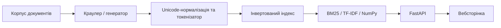

# Findex — пошукова система на Python

Навчальна пошукова система з інвертованим індексом, BM25, TF-IDF, NumPy-прискоренням і вебінтерфейсом FastAPI.

**Жива демонстрація:** https://findex-nz9g.onrender.com/
**GitHub:** https://github.com/eetsyyy/Findex
**Відео (2–3 хв):** _потрібно записати й додати посилання перед здачею_.


| Головний показник | Результат |
|---|---:|
| Документів у поточному Render-корпусі | **1000** |
| p95 відповіді API (Render, 20 с, 20 клієнтів, запит `python`) | **1283,4 мс** |
| Максимальне локальне прискорення NumPy на корпусі 2000 документів | **8,79×** |

> **Про дані:** корпус складається з 200 документів із навчального набору краулера та 800 окремих синтетичних текстів, створених генератором. Це **не** корпус із 1000 незалежних реальних статей. Вимога щодо реальних текстів, якщо викладач її встановив, потребує окремого виконання.

## Що вміє Findex

- Індексує текстові файли, нормалізує Unicode і токенізує документи.
- Виконує логічний і ранжований пошук (BM25 і TF-IDF).
- Підтримує старий Python-скорер (`legacy`) і NumPy-скорер (`numpy`).
- Публікує FastAPI-сервіс із `/health`, `/stats`, `/search` та вебсторінкою.
- Містить експерименти з `memmap` як альтернативу необов'язковому семантичному пошуку.

## Схема обробки даних



## Встановлення і запуск локально

Команди виконувати **всередині вкладеної папки `findex/`**, де знаходиться `pyproject.toml`:

```powershell
uv sync --extra dev
uv run python scripts/prepare_web_corpus.py results/lab06/crawl_5.jsonl --out web_corpus
uv run python scripts/expand_web_corpus.py --out web_corpus --target 1000
uv run findex index web_corpus --out web_index.bin
uv run ruff check .
uv run pyright
uv run pytest -q --benchmark-disable
```

Вебсервер у контейнері стартує через `uvicorn findex.web:app`. Актуальна конфігурація побудови корпусу та індексу міститься у [`Dockerfile`](Dockerfile).

## Актуальні вимірювання публічного сервісу

**Корпус:** 1000 документів, 1300 термінів, середня довжина документа 158,52 токена (за `/stats`).

**Метод:** `oha -z 20s -c 20`, URL `/search?q=python&k=10&engine=numpy`.

| Показник | Виміряне значення |
|---|---:|
| Запитів за секунду | 23,4338 |
| p50 | 897,2 мс |
| p95 | 1283,4 мс |
| p99 | 1434,0 мс |
| HTTP 200 | 449 |
| Запитів, перерваних після дедлайну тесту | 20 |
| Результати за `python` (NumPy / legacy) | 800 / 800 |

Десять перших `doc_id` для запиту `python` мають однаковий порядок у режимах NumPy та legacy. Старі числа для 200 документів і запиту `page` — **історичні**, їх не можна вважати контрольованим порівнянням із цим тестом.

## Лабораторна №8: ключове порівняння скорерів

| Корпус | Тип запиту | Python, мс | NumPy, мс | Прискорення |
|---|---|---:|---:|---:|
| 200 | Частий термін | 0,4939 | 0,0898 | 5,50× |
| 200 | Рідкісний термін | 0,0111 | 0,0395 | 0,28× |
| 200 | Три терміни | 0,5068 | 0,1772 | 2,86× |
| 2000 | Частий термін | 2,6426 | 0,3007 | 8,79× |
| 2000 | Рідкісний термін | 0,0278 | 0,0542 | 0,51× |
| 2000 | Три терміни | 7,1581 | 1,6682 | 4,29× |

**Висновок:** NumPy найбільше допомагає на довгих списках постінгів. Для рідкісних термінів накладні витрати на масиви можуть перевищувати виграш, тому прискорення буває меншим за 1×.

**Профілювання до оптимізації:** `cProfile` указав на обробку частот через `Counter` (~0,154 с), токенізацію (~0,127 с) та читання документів (~0,071 с) у відповідному локальному запуску. Ці функції можуть перетинатися за вкладеним часом, тому значення не слід додавати одне до одного. Результат `py-spy` у Windows отримати не вдалося; flame graph побудовано з `cProfile`. Scalene запускали, але його вивід не дозволяє достовірно приписати конкретні частки Python/native коду цим трьом функціям.

**Файли доказів:** [flame graph пошуку](docs/search_flame.svg), [flame graph індексації](docs/index_flame.svg), [порівняння NumPy](results/lab08/benchmark.csv), [pytest-benchmark](results/lab08/pytest_benchmark.json).

**Альтернатива semantic:** експеримент із memory-mapped постінгами і корпусом, збільшеним із 200 до 2000 документів. `mode=semantic` і `mode=hybrid` **не реалізовані**; це дозволена альтернативна гілка завдання, а не виконаний семантичний пошук.

## Зведені вимірювання лабораторних №1–8

Нижче зібрано таблиці з попереднього README. **Це історичні вимірювання з різних етапів**, які не обов'язково відтворюють поточний стан розгортання. Детальні пояснення та старі інструкції збережено в [архіві попереднього README](docs/README-before-final-cleanup.md).

### Лабораторна №1: Генератори та пам’ять

| Показник                                    | Значення |
| ------------------------------------------- | -------: |
| Кількість документів                        |      120 |
| Загальна кількість токенів                  |   64 380 |
| Кількість унікальних слів (розмір словника) |      188 |

| Алгоритм          | Документів | Токенів | Унікальних слів | Пікова пам'ять (MiB) | Час (с) |
| ----------------- | ---------: | ------: | --------------: | -------------------: | ------: |
| Eager — списки    |        120 |  64 380 |             188 |                5.967 |  0.3363 |
| Lazy — генератори |        120 |  64 380 |             188 |                0.186 |  0.4175 |

### Лабораторна №2: Інвертований індекс і структури даних

| Представлення             | Документів | Пік пам'яті побудови (MiB) | Pickle, байт | Pickle load, с | JSON, байт | JSON load, с |
| ------------------------- | ---------: | -------------------------: | -----------: | -------------: | ---------: | -----------: |
| Звичайний dataclass       |        120 |                     0.3600 |       36 681 |        0.00086 |     26 067 |      0.00069 |
| dataclass зі `slots=True` |        120 |                     0.2870 |       30 518 |        0.00438 |     26 067 |      0.06661 |
| Два `array('I')`          |        120 |                     0.2448 |       27 091 |        0.00029 |     26 067 |      0.00100 |

| Представлення             | Побудова, с | Save pickle, с | Save JSON, с |
| ------------------------- | ----------: | -------------: | -----------: |
| Звичайний dataclass       |      0.1173 |        0.00131 |      0.00065 |
| dataclass зі `slots=True` |      0.1209 |        0.00255 |      0.00067 |
| Два `array('I')`          |      0.1358 |        0.00058 |      0.00070 |

| Запит                 | Кількість результатів | Merge, мс |  Set, мс |
| --------------------- | --------------------: | --------: | -------: |
| `стаття тема` (часті) |                   120 |  0.025792 | 0.020778 |
| `10 100` (рідкі)      |                     0 |  0.003941 | 0.004239 |

### Лабораторна №3: Ранжування та якість пошуку

| Перевірка                                                       | Результат                                      | Висновок               |
| --------------------------------------------------------------- | ---------------------------------------------- | ---------------------- |
| Рідкісне слово (`df=1`) проти частого (`df=70`), `tf=1`         | 4.209655 проти 0.359508                        | Рідкісне слово вище    |
| Двадцяте входження проти дев'ятнадцятого                        | Приріст 0.019260; перше входження дає 2.263745 | Насичення частоти      |
| Короткий документ (`len=50`) проти довгого (`len=1000`), `tf=1` | 2.920962 проти 0.448266                        | Короткий документ вище |

| Запит          | Група | TF-IDF P@5 | BM25 P@5 |
| -------------- | ----: | ---------: | -------: |
| python         |     0 |       1.00 |     1.00 |
| генератори     |     0 |       1.00 |     1.00 |
| індекс         |     1 |       1.00 |     1.00 |
| київ           |     1 |       1.00 |     1.00 |
| unicode        |     2 |       1.00 |     1.00 |
| токенізація    |     2 |       1.00 |     1.00 |
| продуктивність |     3 |       1.00 |     1.00 |
| пам'яті        |     3 |       1.00 |     1.00 |
| ліниве         |     4 |       1.00 |     1.00 |
| жадібне        |     4 |       1.00 |     1.00 |
| **Середнє**    |     — |   **1.00** | **1.00** |

### Лабораторна №4: CLI, тестування та якість коду

У четвертій лабораторній розвивався інтерфейс командного рядка Findex, покращувалося представлення результатів пошуку та перевірялася якість коду.

| Компонент | Реалізація / результат |
|---|---|
| CLI | Команди `findex index`, `findex search`, `findex stats` |
| Виведення результатів | Таблиці Rich та режим `--json` |
| Структурований результат | Поля `doc_id`, `title`, `score`, `path`, `snippet` |
| Тести | `test_lab04_cli.py`, `test_lab04_properties.py` |
| Статичні перевірки | Ruff, Pyright |
| CI | GitHub Actions |
| Історичне покриття | 72% — попередній локальний вимір із README тегу `lab-04` |

**Висновок:** Findex отримав зручніший інтерфейс для запуску й автоматизованих перевірок. JSON-виведення дає змогу обробляти результати іншими програмами, а Rich-таблиці полегшують ручну перевірку.

**Обмеження історичного вимірювання:** 72% — не актуальна оцінка покриття версії v1.0.0. У старому README зазначено, що частина property-based перевірок потребувала додаткового налаштування `hypothesis`.

### Лабораторна №5: Потоки, процеси та GIL

| Виконавець | Воркери | GIL ON, с | GIL OFF, с |
| ---------- | ------: | --------: | ---------: |
| Serial     |       1 |     0.213 |      0.203 |
| Serial     |       2 |     0.209 |      0.218 |
| Serial     |       4 |     0.199 |      0.196 |
| Serial     |       8 |     0.202 |      0.209 |
| Serial     |      12 |     0.196 |      0.196 |
| Threads    |       1 |     0.181 |      0.200 |
| Threads    |       2 |     0.237 |      0.165 |
| Threads    |       4 |     0.343 |      0.101 |
| Threads    |       8 |     0.340 |      0.081 |
| Threads    |      12 |     0.379 |      0.081 |
| Processes  |       1 |     0.482 |      0.450 |
| Processes  |       2 |     0.403 |      0.380 |
| Processes  |       4 |     0.396 |      0.580 |
| Processes  |       8 |     0.443 |      0.629 |
| Processes  |      12 |     0.670 |      0.890 |

### Лабораторна №6: Асинхронний краулер

| Concurrency | Wall time, с | Сторінок/с | Помилки | Peak RSS, MiB |
|---:|---:|---:|---:|---:|
| 1 | 12.0655 | 16.5762 | 0 | 42.938 |
| 5 | 4.1352 | 48.3655 | 0 | 43.844 |
| 20 | 6.3934 | 31.2825 | 0 | 45.004 |

### Лабораторна №7: Вебсервіс і навантажувальне тестування

У попередньому README немає окремої перевіреної таблиці для цього етапу; див. історію комітів і звіти в `results/`.

### Лабораторна №8: NumPy, memmap і профілювання

#### Актуальний публічний корпус і API

Після фінального розгортання на Render індекс містить **1000 документів** і **1300 термінів**. 200 документів підготовлено з навчального набору краулера, ще 800 — синтетичні тексти генератора. Це не 1000 незалежних реальних статей.

| Показник | Актуальне значення, корпус 1000 документів |
|---|---:|
| Запит | `python`, `engine=numpy`, `k=10` |
| Конкурентність / тривалість `oha` | 20 клієнтів / 20 с |
| Requests/sec | 23,4338 |
| p50 | 897,2 мс |
| p95 | **1283,4 мс** |
| p99 | 1434,0 мс |
| Успішні HTTP 200 | 449 |
| Незавершені на межі часу тесту | 20 |
| Pytest | 80 пройдених тестів |

Для запиту `python` обидва скорери (`numpy` і `legacy`) знайшли **800** документів. Порядок ідентифікаторів перших 10 результатів збігся. Ця перевірка стосується конкретного запиту і не замінює автоматизованого тестування різних запитів.

#### Прискорення NumPy порівняно з Python-скорером

У таблиці вказано **локальний час обчислення скорера**, а не час HTTP-запиту на Render.

| Корпус | Запит | Python, мс | NumPy, мс | Прискорення |
|---|---|---:|---:|---:|
| 200 | Частий термін | 0,4939 | 0,0898 | 5,50× |
| 200 | Рідкісний термін | 0,0111 | 0,0395 | 0,28× |
| 200 | Три терміни | 0,5068 | 0,1772 | 2,86× |
| 2000 (експеримент ×10) | Частий термін | 2,6426 | 0,3007 | **8,79×** |
| 2000 (експеримент ×10) | Рідкісний термін | 0,0278 | 0,0542 | 0,51× |
| 2000 (експеримент ×10) | Три терміни | 7,1581 | 1,6682 | 4,29× |

**Висновок:** NumPy ефективніший на довгих списках постінгів завдяки векторизованим операціям; для рідкісних термінів накладні витрати NumPy можуть перевищувати виграш. Корпус 2000 — окремий локальний експеримент, а не розмір публічного Render-корпусу.

#### Профілювання: що займало час до оптимізації

Профілювання `cProfile` індексації виявило такі дорогі операції. Вказані часи різних викликів і вкладених операцій можуть перекриватися — їх **не можна підсумовувати** як незалежні частки загального часу.

| Місце | Вимірювання cProfile | Початкова гіпотеза | Висновок |
|---|---:|---|---|
| Підрахунок входжень через `collections.Counter` | ≈0,154 с | Підрахунок великої кількості токенів дорогий | Значний час у підрахунку; частина реалізації виконується нативним кодом |
| Токенізація | ≈0,127 с | Обробка тексту Python-циклом є вузьким місцем | Підтверджено суттєвий час на підготовці токенів |
| Читання документів | ≈0,071 с | Дисковий ввід/вивід впливає на швидкість індексації | Витрати на завантаження тексту теж помітні |

`cProfile` показує час викликів, але **не дає достовірного окремого відсотка Python/native для кожного рядка**. На Windows `py-spy` не вдалося під'єднати до Python-процесу (`Failed to find python version from target process`). `Scalene` було запущено, проте отриманий профіль не дозволив надійно визначити цей розподіл саме для коду Findex. Тому відсотки Python/native не вигадуються. Flame graph отримано з профілю `cProfile` за допомогою `flameprof`; це не графік `py-spy`.

**Файли flame graph:**

- [index_flame.svg](docs/index_flame.svg)
- [search_flame.svg](docs/search_flame.svg)

#### Альтернатива семантичному пошуку: NumPy memmap

За умовою лабораторної замість ембедингів і режимів `semantic` / `hybrid` використано `memmap` та експеримент із корпусом, збільшеним приблизно в 10 разів — із 200 до 2000 документів. Ці цифри описують локальний експеримент, а не публічний корпус на Render.

| Корпус | Запис memmap | Повторне відкриття | Час пошуку |
|---|---:|---:|---:|
| 200 документів | ≈0,7358 с | ≈6,1771 с | ≈0,0858 мс |
| 2000 документів | ≈0,6628 с | ≈6,4421 с | ≈0,3024 мс |

**Висновок:** `memmap` дає можливість працювати з масивами на диску без необхідності тримати всю матрицю в оперативній пам'яті. Водночас повторне відкриття у вимірах було повільним; це обмеження потрібно враховувати. Семантичний пошук у цій версії **не реалізовано**, оскільки обрано дозволену альтернативу.

#### Історичний бенчмарк Render (корпус 200 документів)

**Не плутати з актуальними показниками для 1000 документів.** Під час старого вимірювання використовувався запит `page`, тому порівняння двох результатів не є контрольованим тестом впливу розміру корпусу.

| Показник | Стара версія, 200 документів |
|---|---:|
| Запит | `page`, `engine=numpy`, `k=10` |
| Requests/sec | 28,9830 |
| p50 | 631,3 мс |
| p95 | 1122,6 мс |
| p99 | 1392,7 мс |
| HTTP 200 | 560 |
| Незавершені на межі часу тесту | 20 |

## Перевірки, обмеження і здача

- **Тести:** 80 пройдено; `pyright`: 0 помилок; Ruff: `All checks passed!` (перевірено на локальній машині).
- **CI:** перед здачею переконайтесь, що останній запуск GitHub Actions зелений.
- **Обмеження:** корпус синтетичний; немає семантичного пошуку; `py-spy` не спрацював на Windows; мережеві тести Render залежать від навантаження хостингу.
- **Відео:** потрібно додати реальне посилання на відео тривалістю 2–3 хвилини.
- **Версії:** теги `lab-08` і `v1.0.0` вже створені; перед здачею перевірте, на які саме коміти вони вказують. Не переміщуйте опубліковані теги без усвідомленого рішення.

**Для Classroom:** посилання на публічний репозиторій, де в README є робочий сайт, GIF, відео, таблиці та результати. Окремий PDF або ZIP завдання не вимагає.
